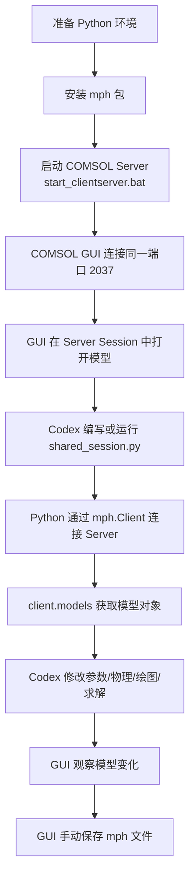

# Codex 接入 COMSOL 并实现近实时 GUI 协作教程

本文档说明如何在当前仓库中跑通一套 COMSOL GUI + Python `mph` + Codex 的共享 Session 工作流。

这套工作流的目标是：

- COMSOL GUI 负责可视化查看、手动微调和最终保存文件。
- Codex 通过 Python 脚本连接同一个本地 COMSOL Server。
- Codex 可以读取 Server 中当前已加载的模型对象。
- Codex 可以修改参数、几何、物理场、绘图配置和求解流程。
- GUI 可以看到 Codex 对同一个 Server 内存模型做出的变化。

> 这不是让 Codex 直接点击 COMSOL GUI。Codex 操作的是 COMSOL Server 内存里的模型对象，GUI 只是同一个 Server 模型的可视化客户端。

## 0. 本教程目标与整体思路

COMSOL Desktop GUI 和 Python/Codex 都连接到同一个 COMSOL Server：

```text
COMSOL GUI  <----\
                 COMSOL Server 内存模型
Python/Codex <---/
```

只要 GUI 和 Python 连接的是同一个 host 和 port，它们看到的就是同一个 Server Session 中的模型对象。

当前仓库中已有一个启动脚本：

```text
start_clientserver.bat
```

它当前使用的 COMSOL 路径和端口是：

```bat
"D:\Softwares_02\COMSOL64\Multiphysics\bin\win64\comsolmphserver.exe" -multi on -port 2037
```

因此本文后续统一使用端口 `2037`。

> 如果你把 `start_clientserver.bat` 改成了其他端口，那么本文所有 Python 脚本和 GUI 连接端口也要一起改成同一个端口。

## 1. 准备工作与依赖安装

### 1.1 必要软件

你需要准备：

- COMSOL Multiphysics 6.4 或较新版本。
- 可以启动 `comsolmphserver.exe` 的 COMSOL Server 功能。
- Python 3.10 或较新版本。
- VS Code 和 Codex 插件，或其他可以让 Codex 读写/运行 Python 脚本的环境。
- Python 包 `mph`。

> COMSOL Desktop 本地打开 `.mph` 文件并不等于已经进入共享 Session。共享 Session 的关键是 GUI 和 Python 都连接同一个 COMSOL Server。

### 1.2 `mph` 包是什么

`mph` 是 Python 连接和控制 COMSOL 的包。脚本里通常这样使用：

```python
import mph

client = mph.Client(version="6.4", port=2037)
models = client.models()
```

其中：

- `mph.Client(...)` 连接本地 COMSOL Server。
- `version="6.4"` 对应 COMSOL 版本。
- `port=2037` 对应本教程使用的 Server 端口。
- `client.models()` 返回当前 Server Session 中已经加载的模型对象列表。

### 1.3 可以使用哪种 Python 环境

本教程不强制你使用某一种环境工具。只要运行脚本的 Python 可以成功执行：

```powershell
python -c "import mph; print('mph ok')"
```

就可以继续。

常见环境方式有三种。

#### 方式 A：Anaconda / Conda

```powershell
conda create -n comsol-mph python=3.11
conda activate comsol-mph
python -m pip install mph
```

如果 `pip install mph` 不可用，可以尝试：

```powershell
python -m pip install MPh
```

安装后检查：

```powershell
python -c "import mph; print('mph ok')"
```

#### 方式 B：Python 自带 `venv`

在当前仓库根目录运行：

```powershell
python -m venv .venv
.\.venv\Scripts\Activate.ps1
python -m pip install mph
```

如果 `pip install mph` 不可用，可以尝试：

```powershell
python -m pip install MPh
```

`python -m venv .venv` 的意思是：用当前 Python 创建一个隔离环境，后续安装的包只放在 `.venv` 里，不污染系统 Python。

#### 方式 C：`uv`

如果本机已经安装 `uv`，可以使用：

```powershell
uv venv
uv pip install mph
```

如果 `uv pip install mph` 不可用，可以尝试：

```powershell
uv pip install MPh
```

`uv` 可以理解为一个更快的 Python 环境和包管理工具。它不是 COMSOL 必需组件，只是帮助你更方便地创建环境、安装包、运行脚本。

> 不要混淆多个 Python。你在哪个 Python 环境里安装了 `mph`，就必须用那个 Python 去运行 `shared_session.py`。

## 2. VS Code / Codex 连接当前 GUI 模型的工作原理

### 2.1 三个角色

这套工作流里有三个角色：

```text
COMSOL Server
```

真正保存当前模型运行状态的地方。参数、几何、物理场、求解状态和结果都在 Server 内存中的模型对象上。

```text
COMSOL Desktop GUI
```

连接 Server 后，用来查看、手动编辑和保存模型。

```text
VS Code / Codex / Python
```

通过 Python `mph` 包连接同一个 Server，读取并修改 Server 内存里的模型对象。

> Codex 修改的是 Server 内存模型，不会自动修改 Python 源文件，也不会自动点击 GUI。

### 2.2 为什么必须使用 `-multi on`

启动 COMSOL Server 时必须使用完整的 `comsolmphserver.exe` 路径，并带上 `-multi on`。示例：

```bat
"C:\Program Files\COMSOL\COMSOL64\Multiphysics\bin\win64\comsolmphserver.exe" -multi on -port 2037
```

> 这里的 `C:\Program Files\COMSOL\COMSOL64\Multiphysics` 是示意路径。请替换成你本机实际的 COMSOL 安装目录。

> [!CAUTION]
>
> 6.3 以下版本默认端口可能为2036，6.4 为2037。请手动在COMSOL软件内确认！

原因是这个工作流至少有两个客户端：

1. COMSOL Desktop GUI。
2. Python/Codex 脚本。

如果没有启用多客户端模式，GUI 连接后，Python 再连接可能报错：

```text
Server is in use by another client
```

### 2.3 `client.models()` 读取的是什么

Python 脚本中：

```python
import mph

client = mph.Client(version="6.4", port=2037)
models = client.models()
```

这里的 `models` 是当前 COMSOL Server Session 里已经加载的模型对象列表。

如果 GUI 已经连接到这个 Server，并且在这个 Server Session 中打开了模型，那么 Python 就应该能从 `client.models()` 里看到它。

> 如果 `client.models()` 返回空列表，通常说明 GUI 没有连接同一个 Server，或者模型只是被 GUI 本地打开了，并没有加载到这个 Server Session。

### 2.4 新手需要先验证，再修改

建议第一步只做读取：

```python
import mph

client = mph.Client(version="6.4", port=2037)
models = client.models()

print(f"Found {len(models)} model(s).")
for index, model in enumerate(models):
    print(index, model.name())
```

只有确认 Python 能看到 Server 里的模型之后，再让 Codex 写修改参数、重建几何、求解或绘图的脚本。

## 3. 使用与操作流程

### 3.1 总体工作流



### 3.2 第一次启动 COMSOL Server

在VS code 终端中运行：

```powershell
.\start_clientserver.bat
```

脚本内容：

```bat
"D:\Softwares_02\COMSOL64\Multiphysics\bin\win64\comsolmphserver.exe" -multi on -port 2037
```

运行后保留这个终端，不要关闭。

> 只要这个窗口关闭，COMSOL Server Session 就会结束，Python 和 GUI 都会断开。

### 3.3 GUI 连接 Server 并打开模型

打开 COMSOL Desktop，在 GUI 中连接本地 Server。

连接信息：

```text
host: localhost 或 127.0.0.1
port: 2037
```

参考截图：


连接成功后，在 GUI 中打开或导入你的 `.mph` 模型。

建议在 COMSOL 文件首选项里修改默认文件位置，避免模型和临时文件默认落在 C 盘。

参考截图：


> GUI 连接的端口必须和 Python 脚本里的 `port=2037` 一致。端口不一致时，GUI 和 Python 会看到不同的 Server Session。

### 3.4 Codex 运行 `shared_session.py`

在当前仓库新建或让 Codex 新建一个 `shared_session.py`。最小检查脚本如下：

```python
import mph

client = mph.Client(version="6.4", port=2037)
models = client.models()

print(f"Found {len(models)} model(s) in COMSOL Server.")

for index, model in enumerate(models):
    print(f"[{index}] {model.name()}")

if not models:
    raise RuntimeError(
        "No model found. Check that COMSOL GUI is connected to port 2037 "
        "and that a model is loaded in the same Server Session."
    )

model = models[0]
print(f"Using model: {model.name()}")
```

运行：

```powershell
python shared_session.py
```

如果使用虚拟环境，改用对应环境的 Python，例如：

```powershell
.\.venv\Scripts\python.exe shared_session.py
```

> 第一次跑通时，先不要写保存文件的代码。先确认 Python 能连接 Server，并且能列出 GUI 当前打开的模型。

### 3.5 修改参数、物理、绘图和求解

确认能拿到模型对象后，可以让 Codex 基于 `shared_session.py` 继续添加操作。

例如修改参数：

```python
model.parameter("radius", "5[mm]")
model.parameter("height", "20[mm]")
```

如果模型使用 COMSOL Java API 的 tag，可以让 Codex 写更具体的操作。例如重建几何：

```python
model.java.component("comp1").geom("geom1").run()
```

运行 study：

```python
model.java.study("std1").run()
```

常见可交给 Codex 的任务包括：

- 读取并列出当前模型参数。
- 修改参数表达式。
- 重建几何。
- 修改物理场设置。
- 运行网格。
- 运行 study。
- 修正绘图组或结果图配置。
- 读取表达式计算结果。

> COMSOL 模型对象通常依赖 tag，例如 `comp1`、`geom1`、`std1`、`pg1`。如果 tag 不确定，先让 Codex 写脚本列出模型树或已有节点，再进行修改。

### 3.6 GUI 观察变化并保存

Python 脚本执行后，回到 COMSOL GUI 查看模型状态。

推荐保存方式：

```text
Python/Codex 修改 Server 内存模型
GUI 检查变化
GUI 手动保存 .mph 文件
```

> 新手阶段不建议让 Python 直接 `model.save()` 覆盖 GUI 正在打开的 `.mph` 文件。这样最容易触发文件锁和误覆盖问题。

## 4. 文件锁与保存策略

### 4.1 `.mph.lock` 是什么

COMSOL 打开 `.mph` 文件时，可能会创建 `.mph.lock` 文件或持有文件句柄。它用于避免多个进程同时覆盖同一个模型文件。

文件锁常见来源有三类：

1. GUI 正在打开该 `.mph` 文件。
2. COMSOL Server 中仍有绑定该文件路径的模型对象。
3. Python 脚本加载了该文件，并尝试保存或覆盖同一个路径。

### 4.2 为什么 Python 保存容易冲突

如果 Python 执行类似操作：

```python
model = client.load("simple_cylinder.mph")
model.save()
```

而 GUI 同时也打开了这个文件，就可能报：

```text
无法保存模型。文件 'simple_cylinder.mph' 已被其他模型锁定。
```

这里的冲突不是 Python 语法问题，而是 GUI、Server、Python 都可能持有同一个模型文件。

> 共享 Session 的推荐原则是：Python 只操作当前 Server 内存中的模型对象，最终由 GUI 手动保存。

### 4.3 推荐保存规则

新手优先遵守以下规则：

- 不让 Python 主动覆盖 GUI 正在打开的 `.mph` 文件。
- Python 只连接 Server，拿到当前模型对象并修改内存状态。
- GUI 负责确认变化和最终保存。
- 如果 Python 必须生成新模型文件，保存到一个新的文件名。
- 如果 Python 加载了临时模型，使用完后清理该模型对象。

### 4.4 清理文件锁的流程

如果遇到 `.mph.lock` 或无法保存：

1. 在 COMSOL GUI 中关闭对应模型标签页。
2. 如果还不行，断开 GUI 与 Server 的连接。
3. 检查 Python 脚本是否仍在运行。
4. 如果 Server 中残留模型对象，重启 COMSOL Server。
5. 确认 `.mph.lock` 消失后，再重新打开模型。

可以写一个检查脚本查看 Server 当前模型：

```python
import mph

client = mph.Client(version="6.4", port=2037)
models = client.models()

print(f"Found {len(models)} model(s).")
for index, model in enumerate(models):
    print(index, model.name())
```

如果你使用 `uv`，可以这样运行：

```powershell
uv run python shared_session.py
```

如果你使用普通 Python 环境：

```powershell
python shared_session.py
```

> 清理文件锁时，不要只删除 `.mph.lock` 文件。真正的问题通常是 GUI 或 Server 仍然持有模型文件。

## 5. 常见问题排查

### 5.1 `ModuleNotFoundError: No module named 'mph'`

说明当前运行脚本的 Python 环境没有安装 `mph`。

检查当前 Python：

```powershell
python -c "import sys; print(sys.executable)"
```

安装：

```powershell
python -m pip install mph
```

如果不可用，尝试：

```powershell
python -m pip install MPh
```

### 5.2 `Server is in use by another client`

通常是 COMSOL Server 没有用多客户端模式启动。

确认启动命令包含：

```bat
-multi on
```

当前推荐启动命令：

```bat
"D:\Softwares_02\COMSOL64\Multiphysics\bin\win64\comsolmphserver.exe" -multi on -port 2037
```

### 5.3 Python 连接不上 Server

检查：

- `start_clientserver.bat` 窗口是否还开着。
- COMSOL Server 是否真的监听 `2037`。
- Python 脚本里的端口是否也是 `2037`。
- GUI 是否连接到了同一个 Server。

> GUI 使用 `2037`，Python 也必须使用 `2037`。不要让 GUI 和 Python 连接不同端口。

### 5.4 `client.models()` 是空列表

常见原因：

- GUI 没有连接到当前 COMSOL Server。
- GUI 连接的是另一个端口。
- 模型只是被 GUI 本地打开，没有加载到 Server Session。
- Server 刚重启，之前的模型对象已经不存在。

解决顺序：

1. 确认 Server 正在运行。
2. GUI 连接 `localhost:2037`。
3. 在 GUI 里重新打开或导入模型。
4. 再运行 `shared_session.py`。

### 5.5 GUI 没看到 Codex 的变化

检查：

- Python 是否连接到了同一个端口。
- Python 是否真的执行到了修改代码。
- 修改后是否需要重建几何、网格或 study。
- GUI 当前显示的是不是同一个 Server 中的模型。

有些修改只改了参数值，不会自动刷新所有绘图。可能还需要运行：

```python
model.java.component("comp1").geom("geom1").run()
model.java.study("std1").run()
```

具体 tag 要按你的模型实际情况调整。

## 6. 核心文件说明

### `start_clientserver.bat`

用于启动支持多客户端连接的 COMSOL Server。

当前内容：

```bat
"你的COMSOL安装路径\COMSOL64\Multiphysics\bin\win64\comsolmphserver.exe" -multi on -port 2037
```

这个文件是共享 Session 的入口。GUI 和 Python 都要连接到它启动的 Server。

### `shared_session.py`

本文没有要求仓库必须预置这个文件。它通常由你或 Codex 在当前仓库中新建，用来连接 Server 并操作当前模型。

最小版本：

```python
import mph

client = mph.Client(version="6.4", port=2037)
models = client.models()

if not models:
    raise RuntimeError("No model found in COMSOL Server.")

model = models[0]
print(model.name())
```

后续 Codex 可以在这个文件中继续补充修改参数、物理、绘图和求解的逻辑。

> `shared_session.py` 是一次性脚本还是反复运行的脚本，取决于你的任务。新手建议每次只做一小步，确认 GUI 中结果正确后再继续下一步。
